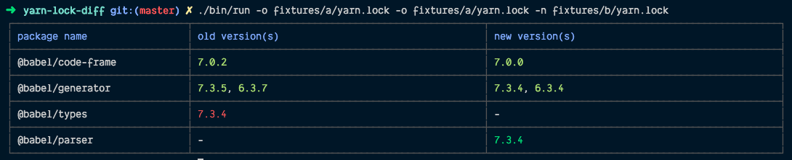

# @yarn-tool/yarnlock-diff

輸入一或多份舊的 `yarn.lock`（Old）與一或多份新的 `yarn.lock`（New），計算並輸出兩者之間的差異（Diff），支援 Yarn v1 與 Berry（v2/v3）。

原句為 "given one or many old yarn.lock, and one or many new yarn.lock, compute the diff for v1 and berry" —— 本套件把 lockfile 解析成「套件名 → 版本清單」的對照表後做深層比對，再渲染成終端機可讀的表格。



[](https://oclif.io)

## Features

- 支援一或多個輸入：`old` / `new` 皆可傳入單一字串、`Buffer` 或陣列，多檔會先合併（Merge）再比對
- 自動解析 Yarn v1 與 Berry（v2/v3）的 lockfile 列（Row），不需要呼叫端自行判斷版本
- 以深層差異（Deep Diff）比對，可區分新增（New）、刪除（Deleted）、編輯（Edited）與陣列變動（Array change）
- 版本號會去重（Deduplicate）並以鬆散 semver 排序，避免同一套件重複列印
- 輸出為 `@yarn-tool/table` 產生的表格，可依選項移除 ANSI 色碼（ANSI Escape Code）
- 提供底層 API，可只取得差異節點（Diff Node）或自行渲染

## Installation

```bash
yarn add @yarn-tool/yarnlock-diff
yarn-tool add @yarn-tool/yarnlock-diff
yt add @yarn-tool/yarnlock-diff
```

## Usage

### 產生差異表格字串

```ts
import { yarnLockDiff } from '@yarn-tool/yarnlock-diff'
import { readFileSync } from 'fs'

const output = yarnLockDiff(
	readFileSync('yarn.lock'),
	readFileSync('yarn-new.lock'),
)

console.log(output)
```

### 一次比對多份 lockfile

```ts
// 舊檔與新檔皆可傳入陣列，同側內容會被合併成單一對照表再比對
const output = yarnLockDiff(
	[readFileSync('legacy/yarn.lock'), readFileSync('v1/yarn.lock')],
	[readFileSync('berry/yarn.lock')],
)
```

### 只取得差異節點，自行處理

```ts
import { buildDiff, buildDiffTable } from '@yarn-tool/yarnlock-diff'

const diff = buildDiff(oldText, newText)

// diff 為 IDiffNode[]，可自行分析；或再渲染成表格
const table = buildDiffTable(diff)
```

## API Documentation

### `yarnLockDiff(yarnlock_old, yarnlock_new, options?): string`

萬用入口函式（Default Export）。內部先以 `buildDiff` 取得差異節點，再交由 `_buildDiffTableCore` 與 `_handleDiffTable` 渲染成表格文字。

| 參數 | 型別 | 說明 |
| --- | --- | --- |
| `yarnlock_old` | `string \| Buffer \| (string \| Buffer)[]` | 舊的 lockfile 內容，可為多份 |
| `yarnlock_new` | `string \| Buffer \| (string \| Buffer)[]` | 新的 lockfile 內容，可為多份 |
| `options` | `IOptionsParseVersionsDiff` | 表格與上色選項，詳見 [Configuration](#configuration) |

**回傳**：`string` — 差異表格文字；若無任何差異則回傳空字串 `''`。

### `buildDiff(oldYarnLockContent, newYarnLockContent): IDiffNode[]`

把兩側 lockfile 各自轉成 `IComputedPackage` 對照表後，用 `@bluelovers/deep-diff` 產生差異節點陣列。輸入與 `yarnLockDiff` 相同，可為多份內容。

**回傳**：`IDiffNode<IComputedPackage, IComputedPackage>[]`；沒有差異時回傳空陣列 `[]`。

### `buildDiffTable(diff, options?): string`

將 `buildDiff` 的結果渲染成表格字串。等價於 `_handleDiffTable(_buildDiffTableCore(diff, options), options)`。

### `_yarnLockDiffCore(yarnlock_old, yarnlock_new, options)`

回傳尚未序列化的中間結果 `{ _ok, table, formatedDiff }`，適合需要自行存取 `table` 物件（例如自訂欄寬、再排版）的進階情境。以下底線開頭表示進階／內部 API。

### `_buildDiffTableCore(diff, options?)`

建立 `table` 與 `formatedDiff`（以套件名為鍵的四欄陣列：名稱、舊版本、箭頭、新版本），並回傳 `_ok` 表示是否真的有差異。

### `_handleDiffTable(result, options?): string`

把 `_buildDiffTableCore` 的結果轉成字串；`_ok` 為 `false`（無差異）時一律回傳 `''`，避免列印空白表格。

### 型別 `IComputedPackage`

```ts
interface IComputedPackage {
	[packagename: string]: string[]  // 套件名 → 排序去重後的版本清單
}
```

## Configuration

本套件無設定檔，所有選項透過第三個參數 `options`（`IOptionsParseVersionsDiff`，定義於 [`@yarn-tool/semver-diff`](../semver-diff/README.md)）傳入：

| 選項 | 型別 | 預設 | 說明 |
| --- | --- | --- | --- |
| `stripAnsi` | `boolean` | `false` | 輸出前移除 ANSI 色碼，方便存檔或送進不支援色彩的環境 |
| `chalk` | `IChalk` | 依環境自動偵測 | 自訂上色實作，可傳入關閉色彩的 chalk |
| `console` | `Console` | 當前 console | 用來判斷輸出目標是否支援色彩的 console 物件 |

```ts
// 產生不含 ANSI 色碼的純文字表格
const output = yarnLockDiff(oldText, newText, { stripAnsi: true })
```

## 相關套件

- [`@yarn-tool/yarnlock-parse`](../yarnlock-parse/README.md) — 將 lockfile 文字解析為物件
- [`@yarn-tool/yarnlock-util`](../yarnlock-util/README.md) — v1/v2 lockfile 列（Row）解析工具，本套件的版本比對基礎
- [`@yarn-tool/semver-diff`](../semver-diff/README.md) — 版本差異上色與 `IOptionsParseVersionsDiff` 定義
- [`@yarn-tool/table`](../table/README.md) — 終端機表格產生器
